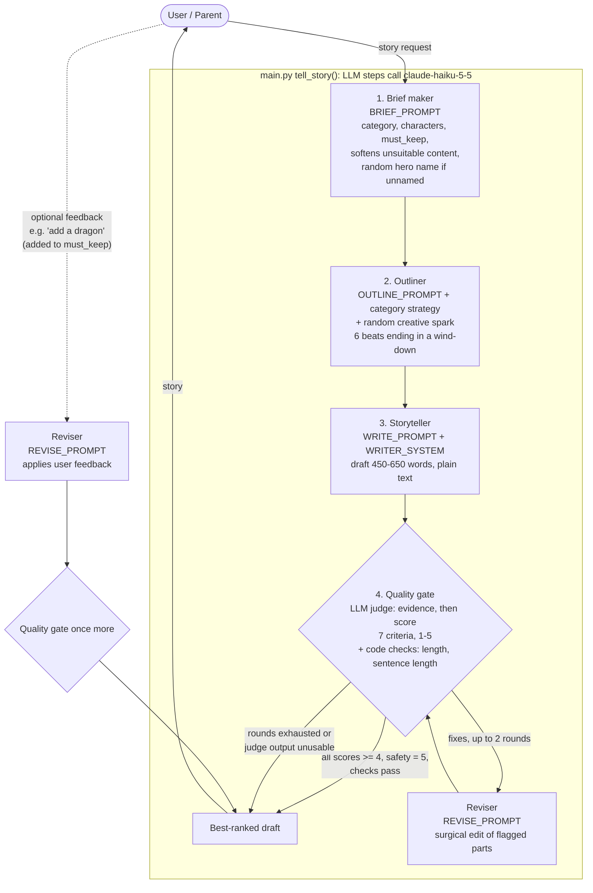

# Bedtime Story Generator (ages 5-10)

Turns a one-line request into a bedtime story using **Claude Haiku 5.5** (`claude-haiku-5-5`),
with an **LLM judge** that scores each draft and sends targeted fixes back to the storyteller.

## Setup & run

Requires Python 3.10+.

```bash
python3 -m venv .venv && source .venv/bin/activate
pip install -r requirements.txt
export ANTHROPIC_API_KEY=<your key>      # never commit your key; .env is git-ignored

python main.py                            # interactive
python main.py "A girl named Alice and her best friend Bob, who is a cat" -v   # -v shows scores, fixes, checks
python -m pytest -q                       # offline tests (fake model, no key needed)
```

Options: `-r N` max judge/revise rounds (default 2), `-v` verbose, `--no-feedback` skip the follow-up prompt, `--seed N` make the random creative spark reproducible.

## How it works

Block diagram (also in `docs/block_diagram.png`):



1. **Brief maker**: classifies the request (adventure, animal friends, fantasy, ...), extracts characters and
   must-keep details (including any quirk, like "a best friend who happens to be a cat"), and *gently reshapes*
   anything unsuitable for ages 5-10 instead of refusing.
2. **Outliner**: picks a strategy per category and plans 6 beats: cozy start, wish, journey, turning point,
   resolution, **wind-down**. It also invents a recurring phrase for read-aloud rhythm.
3. **Storyteller**: writes 450-650 words (about 4 min read aloud) as plain text.
4. **Quality gate** = LLM judge + code checks:
   - The **judge** writes one sentence of evidence per criterion *before* scoring (steadier scores), then scores
     `age_fit`, `request_fidelity`, `story_arc`, `engagement`, `wind_down`, `safety_kindness`, `accuracy` (science) from 1-5 using
     explicit anchors, and returns up to 3 specific fixes that point at the passage.
   - **Code checks** measure what an LLM is bad at: word count and average sentence length. Failures become fixes too.
   - A draft passes when every score is >= 4, safety is 5, and the code checks pass. Otherwise the reviser
     applies the fixes as a *surgical edit* (untouched paragraphs are copied verbatim) and the draft is re-judged
     (max 2 rounds). The best-ranked draft wins (a draft that clears the whole bar beats one that does not; ties keep the earlier draft), so a bad revision
     can never make the result worse.
5. **User feedback loop**: after the story, the child/parent can say "make it funnier" or "add a dragon". The request
   is added to the brief as a required item, the reviser applies it, and the gate runs again so quality and safety
   stay enforced.

### Design choices

- **The wind-down arc (the creative idea):** a bedtime story must be engaging *and* leave the child sleepy. Every
  stage knows this: the outline reserves a calm final beat, the writer shortens sentences in the last third, and
  the judge scores `wind_down` as its own criterion.
- **Code decides pass/fail**, not the model, using the scores and measured checks. This is deterministic and easy to tune
  (`PASS_SCORE`, `MAX_ROUNDS`, `WORD_RANGE`, `MAX_AVG_SENTENCE_WORDS` in `main.py`).
- **Observed in testing:** early on, free-form rewrites sometimes *lowered* scores (a rewrite damaged the ending),
  so the reviser was changed to surgical edits and the loop keeps the best draft.
- **Variety:** early runs kept producing the same names and refrain, so each run draws a random "creative spark" (sensory detail, side character, small twist, and a hero name when the request gives none) for the outliner and the prompts discourage default names.
- **Graceful failure:** JSON parsing tolerates code fences and retries once; an unusable brief or outline falls back to a
  default; an unusable judge means the draft ships; empty or cut-off model replies are handled (higher token limit, a story that ends mid-sentence is sent back for repair, an empty revision keeps the current draft); API errors give a short message instead of a traceback.
- **Prompts are all in `prompts.py`**; model access is a single function, `call_model`.

### Limitations

Haiku judges its own writing (self-preference bias) and judge scores still vary a little between runs; the judge is not
calibrated against human ratings; reading level is only approximated by average sentence length; and the judge's science check is not fully reliable (for "why is the sky blue" it accepted a glitter-in-water demo, which shows reflection rather than scattering).
See the "next two hours" note at the top of `main.py`.
